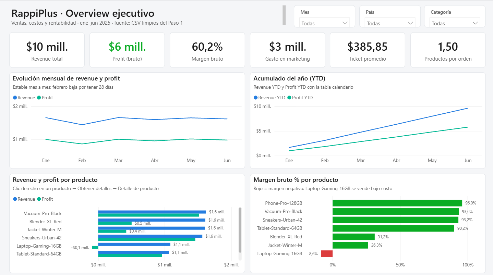
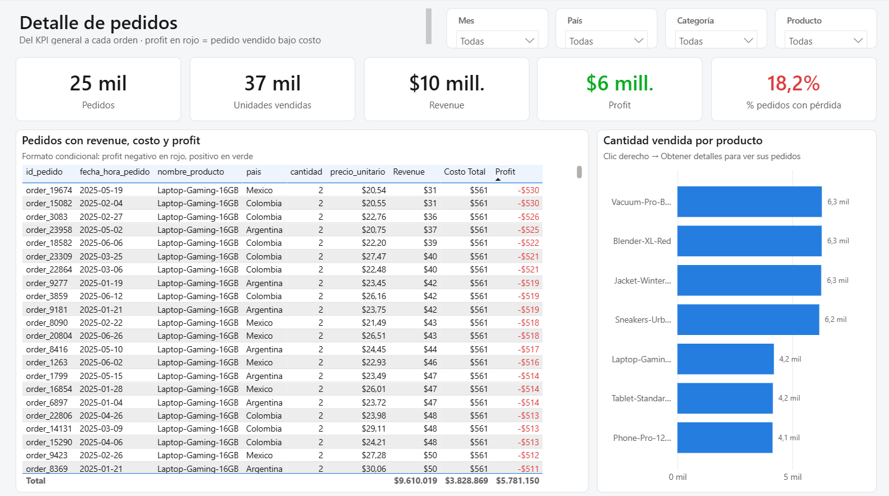
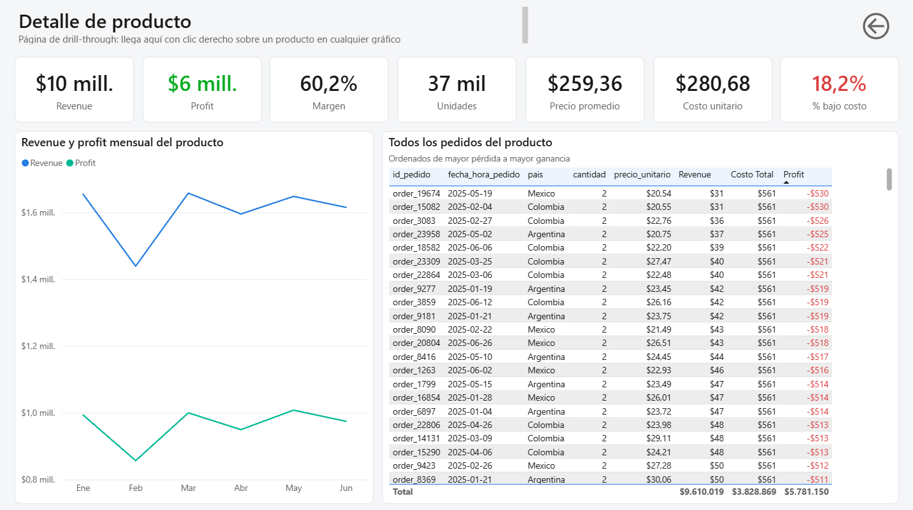
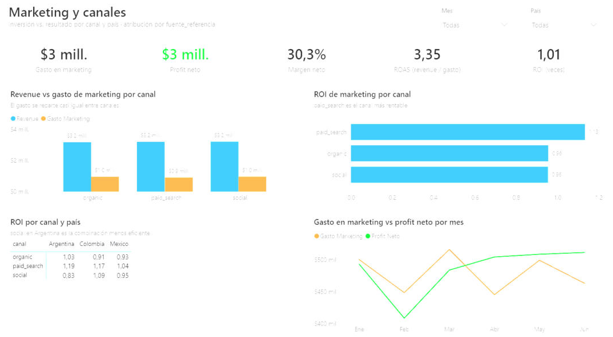
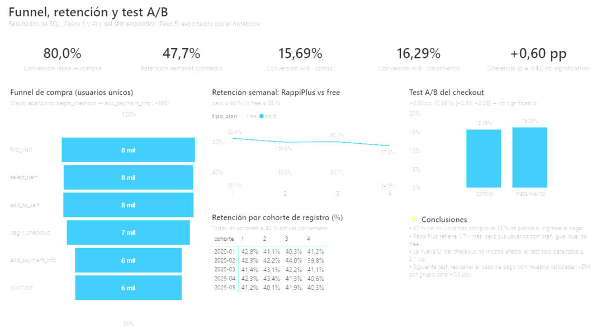

# 🛵 RappiPlus: de datos a decisiones de negocio

Análisis integral de **RappiPlus**, un servicio de suscripción dentro del ecosistema de Rappi diseñado para aumentar la frecuencia de compra y el valor por usuario. El equipo de negocio no tenía claro si el servicio estaba cumpliendo su objetivo, así que el proyecto recorre todo el ciclo analítico: **calidad de datos → rentabilidad → funnel → retención → experimentación → dashboard**.

## 🎯 Preguntas de negocio

| Paso | Pregunta | Herramienta | Resultado |
|---|---|---|---|
| 1 | ¿Podemos confiar en los datos? | Python (pandas) | 3 datasets limpios |
| 2 | ¿Estamos ganando dinero? | Python | KPIs de revenue, costo y profit |
| 3 | ¿Dónde se pierden los usuarios? | SQL (PostgreSQL) | Funnel de conversión |
| 4 | ¿Los usuarios regresan? | SQL | Retención por cohortes |
| 5 | ¿Los cambios generan impacto? | Python (scipy, statsmodels) | Test A/B |
| 6 | ¿Cómo lo comunicamos? | Power BI | Dashboard interactivo |

## 💡 Hallazgos principales

| Indicador | Resultado |
|---|---|
| Revenue (ene–jun 2025) | **$9,61 M** |
| Margen bruto | **60,2 %** |
| Profit neto después de marketing | **$2,91 M (30,3 %)** |
| Conversión visita → compra | **80,0 %** |
| Retención semanal | **~42 %** (RappiPlus ~60 % vs free ~35 %) |
| Test A/B del checkout | **+0,60 pp, p ≈ 0,42 (no significativo)** |

- **Los datos crudos inflaban el negocio 5,4×:** 10 pedidos con cantidades de 10.000–20.000 unidades. Se eliminó solo el 0,77 % de las filas y se recuperaron países y dispositivos con el historial de cada usuario.
- **Los precios no están ligados al costo:** cada producto se vende entre $20 y $500 sin importar su costo. El 18 % de los pedidos se vende con pérdida ($666 K) y Laptop-Gaming-16GB es el único producto con profit negativo.
- **El mayor abandono está en el pago:** 958 usuarios (13,3 %) inician el checkout y nunca registran un método de pago; el patrón se repite en todos los segmentos y meses.
- **RappiPlus genera engagement, no más compras:** los suscriptores son 1,7× más activos, pero convierten, compran con la misma frecuencia y gastan lo mismo que los usuarios free.
- **El test A/B estaba sub-dimensionado:** con ~5.000 usuarios por grupo tenía 13 % de potencia; para confirmar +0,6 pp harían falta ~59.000 usuarios por grupo.
- **paid_search es el canal más rentable** (ROI 1,13 vs ~0,96 de social y organic), aunque el presupuesto se reparte casi en partes iguales.

### Recomendaciones
1. Fijar un **precio mínimo por producto** ligado al costo (palanca más grande de rentabilidad).
2. **Rediseñar y volver a testear el paso de pago** con la métrica `begin_checkout → add_payment_info` y una muestra calculada de antemano.
3. **Reasignar presupuesto hacia paid_search** y revisar social en Argentina (ROI 0,83).
4. **Atar los beneficios de RappiPlus a la compra** (envío gratis sobre un monto mínimo, cashback) y medir pedidos por suscriptor.
5. **Gobierno de datos:** validar cantidades en el origen, unificar catálogos y cerrar huecos de tracking del funnel.

## 🛠️ Proceso

**1. Calidad de datos (Python):** duplicados, fechas, mayúsculas inconsistentes, categorías sin tilde, nulos imputados con el historial del usuario, cantidades negativas y atípicas, consistencia `monto_total = cantidad × precio − descuento`, integridad referencial y pruebas automáticas (`assert`).

**2. Rentabilidad (Python):** costo por pedido uniendo con el catálogo, cascada revenue → profit neto, margen por producto, precio vs costo, segmentos, evolución mensual, ROI/ROAS de marketing por canal y país, recompra y economía unitaria.

**3. Funnel (SQL):** usuarios únicos por etapa, conversión entre pasos con `LAG` y `FIRST_VALUE`, funnel estricto, funnel por segmento y tendencia mensual.

**4. Cohortes (SQL):** cohortes por mes de registro con `DATE_TRUNC` y `CAST(... AS DATE)`, retención semanas 1–4, comparación RappiPlus vs free y cruce con los pedidos reales.

**5. Test A/B (Python):** hipótesis bilateral, prueba Z de dos proporciones (confirmada con χ²), chequeo de SRM y balance de covariables, análisis de potencia y MDE, bootstrap, probabilidad bayesiana, segmentos con corrección de Bonferroni y métrica de control.

**6. Dashboard (Power BI):** modelo en estrella (`orders`, `catalog`, `dim_fecha`, `marketing`, `dim_pais`, `dim_canal`), columnas calculadas con `RELATED`, tabla calendario en DAX y 36 medidas (YTD, mes anterior, año anterior, ROI, formato condicional).

## 🖥️ Dashboard

1. **Overview ejecutivo:** revenue, profit, margen, gasto en marketing, ticket promedio y productos por orden; evolución mensual, YTD y rentabilidad por producto.
2. **Detalle de pedidos:** tabla de órdenes con profit en rojo/verde y cantidad vendida por producto.
3. **Detalle de producto:** página de *drill-through* con KPIs, evolución y todos los pedidos del producto.
4. **Marketing:** gasto, profit neto, ROAS y ROI por canal y país.
5. **Funnel, retención y A/B:** resultados de SQL y del test estadístico.

### Capturas

**Overview ejecutivo**

**Detalle de pedidos**

**Detalle de producto (drill-through)**

**Marketing y canales**

**Funnel, retención y test A/B**

## 📁 Contenido del repositorio

| Archivo | Descripción |
|---|---|
| `RappiPlus_Proyecto_Final.ipynb` | Notebook con limpieza, KPIs, SQL, cohortes y test A/B |
| `RappiPlus_Dashboard.pbix` | Dashboard de Power BI Desktop (5 páginas) |
| `data/` | CSV limpios usados en el dashboard |
| `img/` | Capturas del dashboard |

## 🧰 Herramientas

Python (pandas, matplotlib, seaborn, scipy, statsmodels) · SQL (PostgreSQL) · Power BI (Power Query, DAX) · Estadística inferencial · Storytelling con datos

*Proyecto final del programa de Data Analyst de TripleTen. Los datos son ficticios.*
